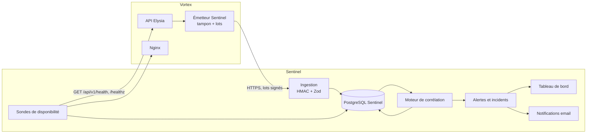
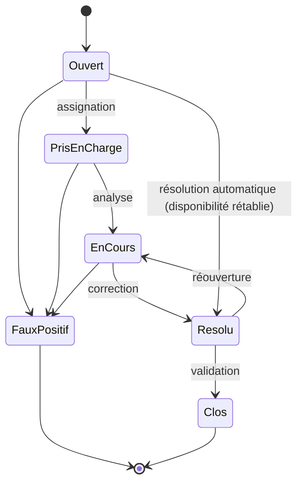

# Conception de Vortex Sentinel

Version 0.1 — 2026-11-03. Document de travail.

## 1. Rôle et périmètre

Vortex Sentinel surveille en continu la plateforme Vortex (API, application web, administration) pour détecter les
interruptions, les dysfonctionnements, les menaces de sécurité et les anomalies métier, puis les transformer en incidents
suivis jusqu'à leur résolution.

Chaîne de traitement :

```
collecte → normalisation → corrélation → alerte → incident
```

Correspondance avec le cahier des charges :

| Exigence | Où elle est couverte |
|---|---|
| Vérifier que Vortex est accessible, détecter les interruptions | Sondes (§ 3.2), R01, R02 |
| Surveiller les services essentiels | Sondes API, base, Nginx, certificat TLS, disque ; échecs d'envoi d'email (R16) |
| Détecter les erreurs, bugs et dysfonctionnements | Événements techniques (§ 4.2), R03, R04 |
| Surveiller les journaux | Journaux de l'API via l'émetteur, journal d'accès Nginx lu par Sentinel (§ 4.2) |
| Identifier les comportements anormaux, signaler l'inhabituel | Références comportementales (§ 6.1), R09, R10, R13 |
| Connexions suspectes, force brute, intrusion | R05 à R09, R14 |
| Centraliser, classer par gravité, historiser, suivre jusqu'à la résolution | § 7 |
| Détecter **avant** que les utilisateurs soient touchés | Règles d'alerte précoce : latence (R03), certificat (R15), disque (R17) |

Hors périmètre de la première version : apprentissage automatique, réponse automatique (blocage d'IP, verrouillage de
compte), métriques système autres que l'espace disque (CPU, mémoire), surveillance d'autres applications que Vortex.

## 2. Principes d'architecture

1. **Indépendance** : Sentinel tourne dans un processus séparé, avec sa propre base. Une panne de Vortex ne doit pas
   l'empêcher de la constater ni d'alerter.
2. **Sentinel n'a aucun accès à la base de Vortex.** Vortex pousse ses événements ; Sentinel ne lit jamais les tables
   métier. L'isolation multi-entreprises (RLS) de Vortex n'est donc pas contournée.
3. **La surveillance ne dégrade pas le service** : l'émission d'événements est asynchrone, bornée en mémoire et ne bloque
   jamais une requête. Une perte d'événements est acceptée, mais comptée et signalée.
4. **Minimisation des données** : pas de contenu métier nominatif (nom de client, libellé de produit), pas de secret,
   pas d'adresse email en clair.
5. **Sobriété** : PostgreSQL suffit pour le stockage et la corrélation aux volumes d'une plateforme de PME. Pas
   d'Elastic, de Kafka ni de Redis.
6. **Ne pas faire confiance au producteur** : tout événement reçu est authentifié, validé (Zod) et horodaté à la
   réception.

## 3. Architecture



### 3.1 Côté Vortex : l'émetteur

Un module ajouté à `apps/api` (dans le dépôt Vortex) :

- **points de capture** :
  - un hook `onAfterResponse` d'Elysia : route normalisée, statut, durée, utilisateur ;
  - le hook `after` de Better Auth : connexions réussies et échouées, réinitialisations, codes OTP ;
  - le moteur de commandes (`commands/engine.ts`), après le COMMIT, à partir des données déjà écrites dans `AuditEvent` ;
  - le plugin d'erreurs (`common/error-plugin.ts`) : erreurs 500 et refus (401, 403, 409, 413, 422, 429) ;
  - le plugin de télémétrie : erreurs d'interface ;
- **tampon** en mémoire borné (10 000 événements), envoi par lots toutes les 5 secondes ou dès 200 événements ;
- **nouvelles tentatives** avec attente croissante ; au-delà de la capacité, les plus anciens sont abandonnés et comptés ;
- **battement de cœur** toutes les 30 secondes, avec le nombre d'événements envoyés, en attente et abandonnés ;
- **agrégation** des requêtes réussies par minute et par route (nombre, latence p50/p95) : chaque requête n'est pas
  envoyée individuellement, seules les erreurs et les requêtes lentes le sont.

### 3.2 Côté Sentinel

| Module | Rôle |
|---|---|
| Ingestion | `POST /ingest` : vérifie la signature HMAC et l'horodatage (anti-rejeu), valide chaque événement, déduplique par identifiant, enregistre. |
| Sondes | Interroge `GET /api/v1/health` (API + base) et `/healthz` (Nginx web et admin) toutes les 30 s, depuis l'extérieur de Vortex ; vérifie chaque jour la date d'expiration du certificat TLS et toutes les 5 min l'espace disque de la machine. |
| Lecteur de journaux | Lit en lecture seule le journal d'accès Nginx (même machine) : requêtes refusées, introuvables, origines. |
| Corrélation | Évalue les règles à la réception (règles simples) et toutes les 30 s par fenêtres glissantes en SQL (règles de seuil et de séquence). |
| Alertes et incidents | Crée les alertes, les déduplique, ouvre ou alimente les incidents, gère leur cycle de vie. |
| Notifications | Email aux responsables pour les gravités élevée et critique. |
| Tableau de bord | Application web propre à Sentinel : état des services, alertes, incidents, recherche d'événements. Servie par Sentinel, elle reste disponible quand Vortex est en panne. |

**Hébergement** (décidé) : Sentinel tourne sur la même machine que Vortex, dans un conteneur séparé avec sa propre base.
Limite assumée : une panne de la machine elle-même arrête les deux. Elle est discutée dans le chapitre d'évaluation ;
la perspective est une sonde externe ou une seconde machine.

## 4. Inventaire des événements

État dans Vortex : **existe** (donnée déjà produite, il suffit de l'émettre), **partiel** (produite seulement dans les
journaux texte), **à ajouter**.

### 4.1 Disponibilité

| Type | Source | État |
|---|---|---|
| `probe.check` (succès / échec, durée, statut HTTP) | Sondes Sentinel sur `/api/v1/health`, `/healthz` | existe (endpoints) |
| `emitter.heartbeat` | Émetteur | à ajouter |
| `db.unavailable` | `health-plugin.ts` (503 `DATABASE_UNAVAILABLE`) | partiel |
| `tls.certificate` (jours avant expiration) | Sondes Sentinel | à ajouter |
| `host.disk` (espace libre) | Sondes Sentinel | à ajouter |
| `mail.failed` (code de connexion, réinitialisation, notification non envoyés) | `auth/mailer.ts`, file des notifications | partiel |

### 4.2 Technique

| Type | Source | État |
|---|---|---|
| `http.metrics` (par minute et par route) | Émetteur | à ajouter |
| `http.slow_request` (durée > 2 s) | Émetteur | à ajouter |
| `app.error` (500 `INTERNAL`) | `error-plugin.ts` → `logError` | partiel |
| `ui.error` (empreinte, route) | `telemetry-plugin.ts` | partiel |
| `command.effect_failed` (email ou notification non exécuté) | `commands/engine.ts` | partiel |
| `request.rejected` (413 trop volumineux, 400 illisible, 422 validation) | `error-plugin.ts` | à ajouter |
| `log.entry` (avertissements et erreurs écrits par l'API, déjà expurgés par `safe-log.ts`) | Émetteur | partiel |
| `http.access` (requêtes refusées ou introuvables : 4xx, 5xx) | Journal d'accès Nginx (`infra/nginx/web.conf`) | existe |

### 4.3 Sécurité

| Type | Source | État |
|---|---|---|
| `auth.login` (succès / échec, méthode : mot de passe, Google, OTP) | Hook `after` de Better Auth | à ajouter |
| `auth.rate_limited` (429) | Better Auth (`rateLimit`) | à ajouter |
| `auth.password_reset_requested`, `auth.password_changed` | Better Auth | à ajouter |
| `auth.otp_sent`, `auth.otp_refused` (adresse non autorisée, quota) | `otp-guard.ts` | à ajouter |
| `access.denied` (403 `FORBIDDEN`, `ORIGIN_REFUSED`, garde admin) | Moteur de commandes, `admin-guard`, plugins | à ajouter |
| `access.unauthenticated` (401) | `error-plugin.ts` | à ajouter |
| `access.status_changed` (demande d'accès approuvée ou refusée) | Plateforme admin | existe (action admin) |
| `idempotency.conflict` (409, même clé avec un contenu différent) | Moteur de commandes, plateforme | à ajouter |

### 4.4 Métier

Émis après le COMMIT par le moteur de commandes, à partir de `AuditEvent` (action, auteur, boutique, référence, motif).

| Commandes surveillées | Intérêt |
|---|---|
| `sale.create`, `sale.return`, `sale.refund` | Annulations et remboursements anormaux |
| `cash.open`, `cash.movement`, `cash.close` | Écarts de caisse (`CashSession.difference`) |
| `stock.adjust`, `stock.transfer`, `inventory.confirm` | Écarts et ajustements de stock répétés |
| `expense.create`, `expense.reverse`, `purchase.reverse`, `entry.reverse` | Annulations d'écritures |
| `period.lock`, `settings.save` | Changements sensibles de configuration |
| `team.invite`, `team.update` | Changements de rôle et de permissions (élévation de privilèges) |

**À ajouter dans Vortex** : `AuditEvent` ne porte pas de montant. Le résultat des gestionnaires (`HandlerResult`) devra
exposer le montant et la quantité concernés pour les règles métier (sans libellé ni nom de client).

## 5. Modèle d'événement normalisé

Inspiré de l'Elastic Common Schema, réduit au besoin. Version du schéma : 1.

```ts
type SentinelEvent = {
  id: string;               // UUID généré par l'émetteur : déduplication
  schemaVersion: 1;
  occurredAt: string;       // ISO 8601, horloge du producteur
  receivedAt: string;       // ajouté par Sentinel, fait foi pour les fenêtres
  source: 'vortex-api' | 'vortex-web' | 'sentinel-probe';
  category: 'availability' | 'technical' | 'security' | 'business';
  type: string;             // ex. 'auth.login', 'sale.refund'
  outcome: 'success' | 'failure' | 'unknown';
  actor?: { userId?: string; membershipId?: string; role?: string; adminId?: string; emailHash?: string };
  tenant?: { organizationId: string; storeId?: string };
  network?: { ip?: string; userAgent?: string };
  http?: { method: string; route: string; status: number; durationMs: number };
  business?: { operationType: string; reference: string; amount?: number; quantity?: number; currency?: string };
  attributes?: Record<string, string | number | boolean>;
};
```

- `route` est la route normalisée (`/api/v1/commands/:type`), jamais l'URL avec ses paramètres.
- `emailHash` : HMAC-SHA256 de l'adresse avec une clé propre à Sentinel. Il permet de compter les échecs par compte,
  y compris pour une adresse inexistante, sans stocker l'adresse.
- **Adresse IP** (décidé) : conservée en clair 2 ans au plus, puis supprimée. Justification : les attaques préparées
  s'étalent sur des mois (repérage, essais espacés, passage à l'acte quand la vigilance baisse) ; une enquête doit pouvoir
  remonter jusqu'au premier contact. Garanties associées : accès réservé aux opérateurs Sentinel, chaque consultation
  d'événement est journalisée (`operator_audit`), purge automatique à l'échéance. Durée à confronter au cadre légal de
  protection des données applicable et à mentionner dans la politique de confidentialité de Vortex.

**Schéma partagé** (décidé) : Vortex et Sentinel sont dans deux dépôts. Le schéma est défini dans Sentinel (autorité) et
dupliqué dans `@vortex/contracts`, avec un jeu d'exemples commun pour vérifier qu'ils restent compatibles. Une ingestion
qui valide elle-même ce qu'elle reçoit est de toute façon souhaitable pour un SIEM.

## 6. Règles de corrélation (première version)

Toutes les valeurs de seuil sont configurables ; celles-ci sont les valeurs initiales à calibrer pendant l'évaluation.

| Id | Mission | Règle | Gravité |
|---|---|---|---|
| R01 | Disponibilité | 3 échecs consécutifs d'une sonde | Critique |
| R02 | Disponibilité | Aucun battement de cœur depuis 2 min alors que la sonde répond (collecte interrompue) | Élevée |
| R03 | Technique | Latence p95 > 2 s pendant 5 min sur une route | Moyenne |
| R04 | Technique | Plus de 5 % de réponses 5xx sur 5 min (au moins 20 requêtes) | Élevée |
| R05 | Sécurité | ≥ 10 échecs de connexion sur un même compte en 10 min | Élevée |
| R06 | Sécurité | ≥ 20 échecs depuis une même IP sur ≥ 5 comptes en 10 min (bourrage d'identifiants) | Élevée |
| R07 | Sécurité | R05 ou R06, suivie d'une connexion réussie sur le compte visé dans les 30 min | Critique |
| R08 | Sécurité | ≥ 5 refus d'accès pour un même utilisateur en 10 min | Moyenne |
| R09 | Sécurité | Connexion depuis une IP jamais vue pour cet utilisateur (30 jours), suivie d'un `team.update` ou `settings.save` dans l'heure | Élevée |
| R10 | Métier | Retours et remboursements d'un vendeur sur une journée > 3 fois sa moyenne sur 30 jours (au moins 3) | Moyenne |
| R11 | Métier | Clôture de caisse avec un écart supérieur au seuil, ou 3 écarts négatifs pour un même caissier en 30 jours | Moyenne / élevée |
| R12 | Métier | ≥ 3 ajustements négatifs de stock sur un même produit en 7 jours | Moyenne |
| R13 | Métier | Opération de caisse ou remboursement en dehors des horaires habituels de la boutique | Faible |
| R14 | Sécurité | ≥ 30 réponses 404 ou 400 pour une même IP en 5 min (exploration de chemins, tentative d'intrusion) | Moyenne |
| R15 | Disponibilité | Certificat TLS expirant dans moins de 14 jours (moins de 3 jours : critique) | Moyenne / critique |
| R16 | Technique | ≥ 3 échecs d'envoi d'email en 15 min (les utilisateurs ne reçoivent plus leurs codes) | Élevée |
| R17 | Disponibilité | Espace disque libre inférieur à 15 % (moins de 5 % : critique) | Élevée / critique |

Les règles R07 et R09 sont des **règles de séquence** : elles relient des événements de natures différentes (sécurité puis
sécurité, sécurité puis métier). C'est l'apport principal d'un SIEM par rapport à une supervision.

### 6.1 Fonctionnement du moteur

- **Règles unitaires** (R11 sur un écart, R13) : évaluées dès l'ingestion de l'événement.
- **Règles de seuil et de séquence** : requêtes SQL sur fenêtre glissante, exécutées toutes les 30 s à partir du dernier
  point traité (pas de relecture complète).
- **Références comportementales** (R09, R10, R13) : statistiques par acteur et par boutique recalculées chaque nuit
  (moyennes sur 30 jours, IP connues, horaires habituels).
- **Déduplication** : une alerte est identifiée par (règle, clé), par exemple (R05, compte). Tant qu'elle est ouverte,
  les nouveaux déclenchements incrémentent son compteur au lieu de créer une nouvelle alerte.

## 7. Gravité, alertes et incidents

### 7.1 Niveaux de gravité

| Niveau | Signification | Délai de prise en charge visé |
|---|---|---|
| Info | Fait notable, aucune action | — |
| Faible | À examiner | 3 jours |
| Moyenne | Anomalie probable | 24 h |
| Élevée | Menace ou dysfonctionnement avéré | 4 h, notification email |
| Critique | Service interrompu ou compromission probable | Immédiat, notification email |

### 7.2 Des alertes aux incidents

- Une alerte de gravité **moyenne ou plus** ouvre un incident, ou rejoint l'incident ouvert de même clé.
- Une alerte **faible** reste une alerte ; elle peut être rattachée manuellement à un incident.
- Plusieurs alertes peuvent appartenir au même incident (ex. R05 puis R07 sur le même compte) ; la gravité de l'incident
  est la plus haute de ses alertes.

### 7.3 Cycle de vie d'un incident



Chaque transition est historisée (auteur, date, commentaire). Les faux positifs sont comptés par règle pour le calibrage
et l'évaluation.

## 8. Modèle de données Sentinel

| Table | Contenu |
|---|---|
| `event` | Événements normalisés. Partitionnée par mois, conservée 2 ans (suppression d'une partition entière à l'échéance). Ajout seul (aucun UPDATE ni DELETE pour le rôle applicatif). |
| `probe_target`, `probe_result` | Cibles surveillées et résultats des sondes. |
| `emitter_status` | Dernier battement de cœur et compteurs de l'émetteur. |
| `rule` | Règles, seuils, gravité, activation. |
| `rule_checkpoint` | Dernier point traité par règle. |
| `baseline` | Références comportementales par acteur et par boutique. |
| `alert` | Alertes : règle, clé, gravité, compteur, premier et dernier déclenchement, événements liés. |
| `incident`, `incident_alert` | Incidents et alertes rattachées. |
| `incident_history` | Historique des transitions et commentaires. |
| `operator` | Comptes des opérateurs Sentinel, distincts de ceux de Vortex. |
| `operator_audit` | Journal des actions des opérateurs. |

### 8.1 Acteurs et rôles

| Acteur | Droits |
|---|---|
| Administrateur Sentinel | Tout : opérateurs, règles et seuils, cibles des sondes, incidents. |
| Analyste | Consulte les événements, traite les alertes et les incidents (assignation, commentaires, résolution, faux positif). Ne modifie pas les règles. |
| Observateur | Lecture seule du tableau de bord (état des services, incidents), sans accès au détail des événements (ni IP, ni identifiants). Pour un responsable ou un encadrant. |
| Vortex (système) | Envoie des événements à l'ingestion ; aucun autre droit. |

Les utilisateurs de Vortex (propriétaires, vendeurs, caissiers) ne sont pas des acteurs de Sentinel : ils sont surveillés,
ils n'y ont pas accès.

## 9. Sécurité de Sentinel

Un SIEM est une cible : il concentre des informations sensibles et on peut chercher à l'aveugler.

- **Ingestion** authentifiée par HMAC (secret partagé avec Vortex uniquement) et horodatage à ±5 min contre le rejeu.
- **Opérateurs** : comptes propres, double authentification obligatoire, aucune création de compte en libre-service.
- **Lecture seule sur Vortex** : Sentinel n'agit jamais sur Vortex.
- **Intégrité des événements** : table en ajout seul. Perspective : chaînage des lots par empreinte pour détecter une
  suppression.
- **Aveuglement détecté** : un arrêt de l'émetteur déclenche R02.
- Aucun secret dans le dépôt (dépôt public) ; configuration par variables d'environnement.

## 10. Stack et organisation du dépôt

- Bun, Elysia, PostgreSQL, Prisma, Zod, React pour le tableau de bord, comme Vortex.
- Organisation (décidé) :

```
apps/server     ingestion, sondes, moteur de corrélation, API du tableau de bord
apps/web        tableau de bord
packages/schema schéma d'événement (Zod) et exemples partagés
docs/           conception, règles, protocole d'évaluation
```

## 11. Évaluation (chapitre 7 du mémoire)

Scénarios rejoués sur un environnement de test avec des données fictives :

| Scénario | Règles attendues |
|---|---|
| Arrêt de la base de données | R01 |
| Arrêt de l'émetteur | R02 |
| Charge provoquant des lenteurs et des erreurs | R03, R04 |
| Force brute sur un compte, puis connexion réussie | R05, R07 |
| Bourrage d'identifiants depuis une IP | R06 |
| Nouvelle IP puis changement de rôle | R09 |
| Vendeur multipliant les remboursements | R10 |
| Caissier avec écarts négatifs répétés | R11 |
| Exploration de chemins par un scanner | R14 |
| Certificat proche de l'expiration (date simulée) | R15 |
| Serveur email injoignable | R16 |
| Disque presque plein (seuil abaissé pour le test) | R17 |
| Activité normale sur une semaine simulée | Aucune (mesure des faux positifs) |

Mesures : taux de détection, faux positifs, délai entre l'événement et l'alerte, impact de l'émetteur sur la latence de
Vortex.

## 12. Ordre de réalisation

1. Schéma d'événement et ingestion (avec tests).
2. Sondes de disponibilité, R01, R02, R15, R17.
3. Émetteur dans Vortex : authentification, erreurs, emails, commandes ; lecteur du journal Nginx.
4. Moteur de corrélation : R03 à R09, R14, R16.
5. Alertes, incidents et cycle de vie.
6. Tableau de bord.
7. Règles métier R10 à R13 et références comportementales.
8. Notifications email.
9. Scénarios d'évaluation.
